  

My personal collection of prompts for Claude Code.

| Prompt | What it does |
|:--|:--|
| [**REA prompt**](prompts/rea-prompt.md) | Analyses an installed app (reverse engineering) and rebuilds it for private use with React + TypeScript |

  

<table>
<tr>
<td width="50%" valign="top">

**🖥️ On the PC**

- Windows PC with the target app **installed** (the prompt searches the installation folder, Start menu and registry; if it is missing, Claude asks whether to install it)
- [Node.js](https://nodejs.org) (LTS) and npm, to run the Vite + React + TypeScript project
- Git (optional, for versioning the result)

</td>
<td width="50%" valign="top">

**✻ In Claude Code**

- [Claude Code](https://claude.com/claude-code) (desktop app or CLI)
- The **`rea` skill**, placed in `C:\Users\<you>\.claude\skills\rea\` (needs `SKILL.md`, plus its `references/` folder). The prompt calls this skill in step 2, without it step 2 fails.
- Reverse-engineering tools for the `rea` skill. If something is missing, the skill points to its `references/toolchain-setup.md`.
- A browser tool for step 5 (testing every feature): the built-in browser pane of the Claude desktop app, or the Playwright plugin
- Optional: the `agent-skills` plugin for coding skills (specs, tests, code review)

</td>
</tr>
</table>

  

1. Open Claude Code in an empty project folder.
2. Copy the prompt from [prompts/rea-prompt.md](prompts/rea-prompt.md) and replace `[APP-NAME]`.
3. Send it. Claude finds the app, writes the REA report, then builds the rebuild feature by feature.
4. Approve downloads and installs when Claude announces them.

- 📄 The REA report (`rea-<app-name>-fertig.md`)
- 📊 A table: feature in the original ↔ in the rebuild (present / partial / missing)
- 🚀 A runnable project with the start command (usually `npm install` then `npm run dev`)
- 📝 A short list of what is still missing

  

- Own code only: no original code, logos, icons, fonts or brand names, and the rebuild gets its own name
- No real accounts or logins of the app are touched
- For private use only, do not publish the rebuild

  

